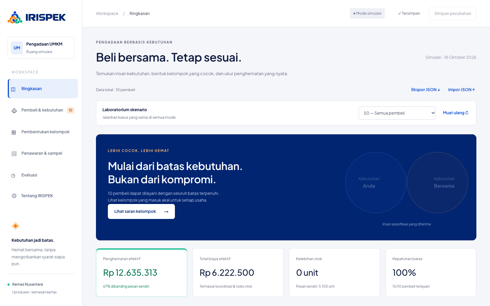
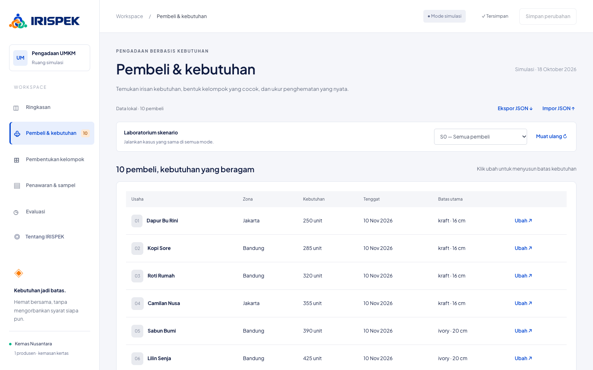
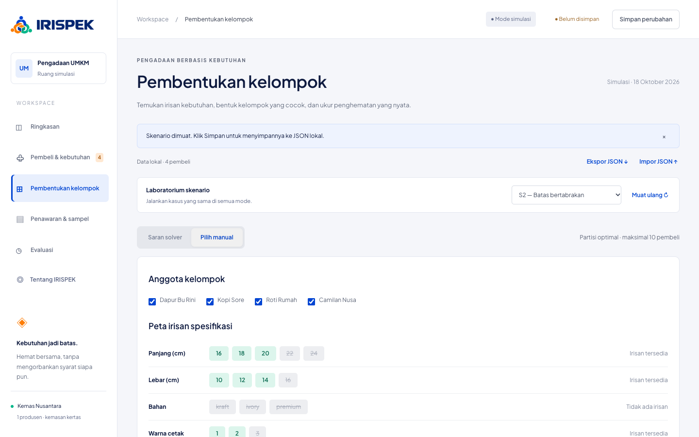
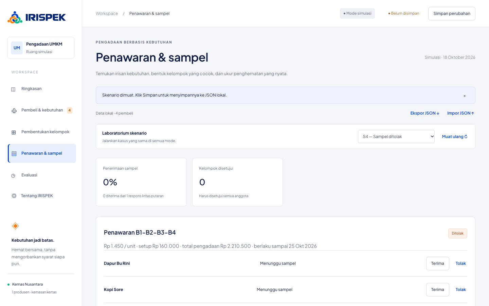
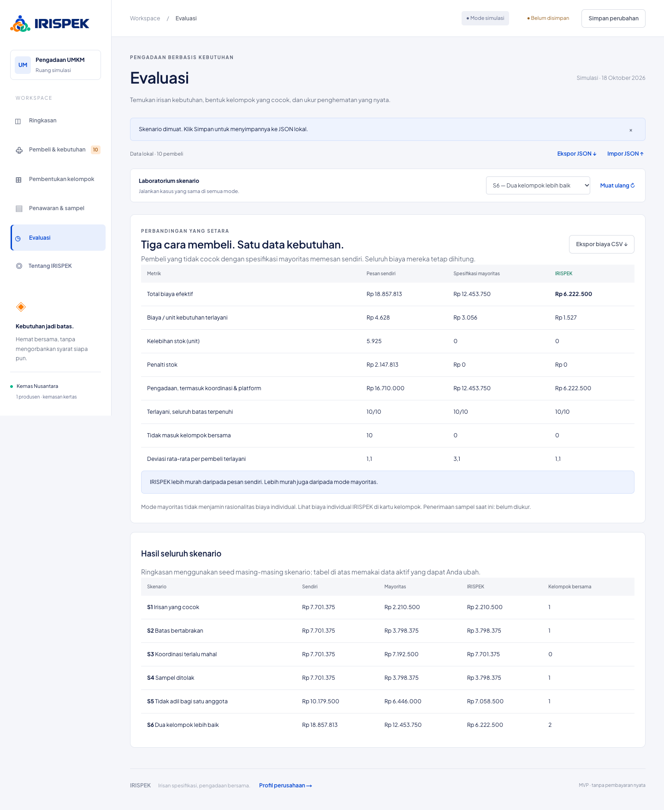

<div align="center">


# IRISPEK

**Pengadaan bersama yang benar-benar sesuai kebutuhan.**

Simulasi pengadaan bersama untuk UMKM: mencari irisan spesifikasi dari beberapa usaha, memesannya sekali, dan memastikan setiap anggota memenuhi seluruh batasnya tanpa membayar lebih mahal daripada memesan sendiri.


</div>

---

Tidak ada pembayaran, pengiriman nyata, atau autentikasi.

Proyek ini berisi dua bagian dengan satu identitas visual:

| Rute   | Isi                                                                           |
| ------ | ----------------------------------------------------------------------------- |
| `/`    | Company profile: masalah MOQ, cara kerja, janji produk, dan angka simulasi.   |
| `/app` | Demo aplikasi: ringkasan, pembeli, pembentukan kelompok, penawaran, evaluasi. |

Stack: Next.js (App Router, webpack), React, TypeScript, Tailwind CSS 4 (hanya `@import`; gaya utama berupa CSS biasa dengan design token di `globals.css`), Vitest, dan Playwright.

## Fitur utama

**Ringkasan** — penghematan efektif, total biaya, dan kelompok yang direkomendasikan solver.



**Pembeli & kebutuhan** — batas spesifikasi tiap pembeli sebagai batas penerimaan.



**Pembentukan kelompok** — peta irisan spesifikasi; nilai katalog yang melanggar batas anggota dicoret (skenario S2: bahan bertabrakan).



**Penawaran & sampel** — penawaran dengan snapshot biaya; seluruh anggota harus menerima sampel (skenario S4).



**Evaluasi** — IRISPEK dibandingkan dengan pesan sendiri dan spesifikasi mayoritas.



## Menjalankan

Butuh Node.js 22+ dan npm.

```sh
npm install
npm run dev        # http://127.0.0.1:3000
```

| Perintah            | Fungsi                                                      |
| ------------------- | ----------------------------------------------------------- |
| `npm test`          | Vitest: invariant solver, validasi, API, skenario S1–S6     |
| `npm run typecheck` | TypeScript                                                  |
| `npm run test:e2e`  | 9 tes interaksi Chrome desktop/mobile (butuh Google Chrome) |
| `npm run build`     | Build produksi                                              |
| `npm start`         | Server produksi setelah build                               |
| `npm run format`    | Prettier                                                    |

## Penyimpanan data

Klik **Simpan perubahan** untuk menyimpan pembeli, konfigurasi, penawaran, dan riwayat sampel ke `data/state.json`; muat ulang browser untuk membaca kembali. Mengganti skenario mereset data aktif dan riwayat sampel di memori; perubahan baru permanen setelah disimpan. Penulisan memakai file sementara + atomic rename, diserialkan dalam satu proses Node, dan dilindungi ETag/If-Match: tab dengan versi lama menerima HTTP 409, bukan menimpa perubahan baru. Ini model lokal satu proses, bukan database multi-server, dan tidak menjamin persistensi pada hosting ephemeral. File rusak tidak ditimpa otomatis.

Indikator **Belum disimpan** menandai perubahan aktif dan browser memperingatkan sebelum keluar. Ekspor/impor JSON menyediakan cadangan (impor memvalidasi ulang kebutuhan dan snapshot biaya, maksimum 200 KB). **Ekspor biaya CSV** pada evaluasi memuat rincian per anggota terlayani. Konflik tab diselesaikan dengan mengekspor perubahan lokal lalu memuat ulang.

Tes browser membangun produksi lalu menjalankan server terisolasi di port 3187 dengan file data di direktori sementara (`BATASBELI_STATE_FILE`), sehingga `data/state.json` tidak berubah. Ubah port di `playwright.config.ts` bila bentrok.

## Struktur dan model

- `src/domain/model.ts`: Pembeli, batas spesifikasi, produsen, rencana dan alokasi, penawaran, sampel.
- `src/domain/config.ts`: seluruh parameter biaya platform, admin, komunikasi, penalti stok, bobot deviasi, ambang penghematan, tujuan spesifikasi, dan tanggal simulasi.
- `src/domain/seed.ts`: 10 pembeli, satu produsen, katalog diskret, tingkat harga, MOQ, biaya cetak dan pengiriman, serta skenario.
- `src/solver/index.ts`: fungsi TypeScript murni, tidak mengimpor React, Next.js, filesystem, atau waktu sistem.
- `src/app/page.tsx` + `profil.css`: company profile (`/`).
- `src/app/app/page.tsx`: demo aplikasi (`/app`): ringkasan, kebutuhan, kelompok manual/otomatis, penawaran/sampel, evaluasi.
- `src/domain/validation.ts`, `state.ts`, `workflow.ts`: validasi bersama UI/API, integritas penawaran, transisi respons sampel.
- `src/server/storage.ts`: antrean penulisan, ETag, atomic rename, dan perlindungan file rusak.
- `src/app/api/state/route.ts`: validasi JSON, origin, batas stream 200 KB, dan konflik versi.
- `src/components/Modal.tsx`: dialog native dengan fokus keyboard, Escape, dan pengembalian fokus.
- `tests/audit.test.ts`, `tests/api.test.ts`, `e2e/app.spec.ts`: regresi audit dan alur browser.
- `tests/solver.test.ts`: unit test, kasus regresi, dan 100 variasi acak deterministik.

Satu kategori: kemasan kertas dengan panjang, lebar, bahan, dan jumlah warna cetak. MOQ dan biaya setup berlaku per varian; dalam simulasi ini semua varian memiliki MOQ/setup sama. Alokasi dan spesifikasi disimpan di snapshot rencana penawaran. Status kelompok direpresentasikan oleh penawaran: ditawarkan, ditolak, disetujui. Kelompok yang baru disarankan belum merupakan komitmen pembelian.

## Desain solver

`solveGroup(buyers, producer, config)` mengembalikan `{plan, issues}`. `solvePartition` dapat diganti implementasinya tanpa mengubah fungsi irisan/alokasi. `intersection` menghitung nilai katalog yang memenuhi **semua** batas anggota. Untuk rentang, ini ekuivalen dengan irisan interval `[max(min), min(max)]` yang dipotong katalog diskret. Untuk pilihan, ini irisan himpunan dan katalog. Bila kosong, laporan menyebut atribut dan seluruh anggota yang membatasi nilai katalog, bukan menuduh seorang pembeli sebagai penyebab tunggal. Laporan ini bukan minimal unsatisfiable core.

Semua tipe batas, termasuk fleksibel, merupakan batas penerimaan. Fleksibel berarti beberapa nilai diterima; preferensi ideal boleh berbeda dari hasil, tetapi batas penerimaannya tidak boleh dilanggar. `wajib_tepat` memakai satu pilihan; rentang inklusif. Kandidat spesifikasi dibentuk dari Cartesian product irisan. Tujuan default biaya minimum; harga dipengaruhi volume dan tambahan bahan premium; beberapa spesifikasi memiliki biaya sama dan dipilih menurut urutan katalog. Opsi deviasi memilih penyimpangan ideal tertimbang minimum di antara kandidat yang lolos rasionalitas individual. Baseline sendiri selalu memakai biaya minimum, juga ketika tujuan kelompok adalah deviasi. Perubahan tujuan tidak melemahkan pemeriksaan batas/biaya individual.

Solver memeriksa seluruh subset (maksimum 1.023 pada 10 pembeli), memangkas konflik katalog, tenggat, dan biaya individual, kemudian memakai dynamic programming bitmask untuk mencari partisi dengan total biaya efektif minimum. Subset dalam recurrence selalu memuat anggota pertama tersisa agar partisi tidak dievaluasi berulang urutannya. Kompleksitas partisi O(3^n), dengan enumerasi kandidat spesifikasi tambahan; sesuai skala 10, tidak cocok untuk ratusan pembeli. Singleton adalah opsi pesan sendiri. Pembeli yang bahkan tidak dapat memesan sendiri ditandai tidak terlayani; pembeli singleton tetap terlayani tetapi tidak mendapat kelompok bersama.

Tenggat dicek terhadap tanggal simulasi + lead time dalam UTC. Kalender libur, kapasitas produksi, dan variasi lead time belum dimodelkan. Mengubah tanggal awal tersedia di panel parameter.

## Harga, alokasi, dan rasionalitas individual

1. Kandidat jumlah produksi = maksimum(MOQ, total kebutuhan) **dan setiap ambang harga di atasnya**. Solver memilih kandidat dengan biaya efektif terbaik, termasuk penalti tambahan stok. Misalnya kebutuhan sendiri 1.900 unit dapat lebih murah jika memesan 2.000, tetapi tidak ketika risiko stok terlalu tinggi. Baseline sendiri dan mode mayoritas memakai kebijakan jumlah yang sama. Tingkat harga memakai **jumlah produksi**, bukan hanya kebutuhan. Bahan premium menambahkan Rp1.800/unit (`materialSurcharge` pada produsen).
2. Unit produksi dialokasikan proporsional kebutuhan, dibulatkan ke bawah, lalu sisa unit dibagikan dengan metode largest remainder. Total unit selalu konservatif; tidak ada stok pecahan.
3. Pembeli membayar unit alokasinya × harga satuan. Setup, platform, dan koordinasi dibagi menurut proporsi kebutuhan. Cetak desain dibebankan per pembeli; kirim per pembeli sesuai zona. Tidak diasumsikan ada diskon pengiriman gabungan.
4. Koordinasi = biaya waktu admin per kelompok + biaya komunikasi per anggota. Singleton tidak memiliki koordinasi/platform kelompok.
5. Penalti stok = unit berlebih × harga satuan × `stockRate`. Ini biaya tambahan simpan/risiko kedaluwarsa, **bukan** biaya pembelian stok kedua kalinya.
6. Biaya efektif = pengadaan + penalti stok. Biaya per unit efektif dibagi kebutuhan asli pembeli, bukan jumlah yang dipaksa dibeli akibat MOQ.
7. Setiap calon kelompok ditolak bila biaya efektif seorang anggota lebih besar daripada biaya sendiri terbaik atau tidak mencapai `minimumSaving`. Anggota tersebut dapat kembali terpilih di kelompok lain atau singleton. Default ambang 0 mengizinkan biaya sama sesuai syarat `<=`; setel ambang positif, misalnya Rp1, untuk penghematan ketat per anggota. Tidak ada subsidi silang.

Perhitungan internal mempertahankan pecahan Rupiah; UI membulatkan hanya untuk tampilan sehingga penjumlahan angka tampilan dapat berselisih beberapa Rupiah. Tidak ada pembulatan pembayaran karena ini simulasi.

Skor deviasi numerik = selisih absolut terhadap ideal / maksimum(1, lebar rentang), dikalikan bobot atribut. Atribut kategori/pilihan bernilai 0 bila ideal terpenuhi dan 1 bila berbeda (untuk pilihan numerik tanpa rentang, selisih dinormalisasi 1). Bobot global dipakai pada tujuan ideal. Deviasi tidak dapat membeli pelanggaran batas.

## Alur UI dan skenario siap-jalan

Pilih skenario dari **Laboratorium skenario**. Untuk membandingkan manual dan otomatis, buka **Pembentukan kelompok** dan ganti tab. Mode manual menampilkan peta nilai katalog serta alasan penolakan; tombol alternatif membuka partisi solver. Evaluasi selalu menggunakan data dan parameter aktif, serta menyediakan tabel seluruh seed skenario terpisah.

| Skenario | Langkah dan hasil yang diharapkan                                                                                                                                                                                                                                                                            |
| -------- | ------------------------------------------------------------------------------------------------------------------------------------------------------------------------------------------------------------------------------------------------------------------------------------------------------------ |
| S1       | Empat pembeli kraft, kelompok manual layak, seluruh anggota hemat dibanding pesan sendiri.                                                                                                                                                                                                                   |
| S2       | Pilih semua empat pembeli secara manual: irisan bahan kosong. Saran otomatis membentuk kelompok tiga pembeli kraft dan satu pesanan sendiri ivory.                                                                                                                                                           |
| S3       | Admin Rp5 juta: kelompok empat ditolak akibat biaya individual. Solver memilih empat singleton dan jujur menunjukkan penghematan nol.                                                                                                                                                                        |
| S4       | Skenario langsung membuka penawaran dengan sampel b4 ditolak karena bahan. Klik **Tinjau & hitung ulang**, pilih ivory, centang persetujuan pembeli, lalu ubah batas. Kelompok lama dibatalkan; solver menghasilkan kelompok tiga kraft dan singleton ivory. Penolakan tetap dihitung dalam riwayat respons. |
| S5       | b1 membutuhkan 4.000 unit dan koordinasi Rp800 ribu. Kelompok besar melanggar rasionalitas b1 meski anggota kecil dapat diuntungkan. Solver mengeluarkan b1 ke pesanan sendiri.                                                                                                                              |
| S6       | Sepuluh pembeli menerima bahan pilihan masing-masing atau premium, dengan ukuran bersama yang tersedia. Satu kelompok memerlukan premium yang lebih mahal Rp1.800/unit. Solver memilih dua kelompok non-premium yang lebih murah daripada satu kelompok premium pada mode mayoritas.                         |

Pada S6 spesifikasi bersama premium memenuhi batas penerimaan semua pembeli, tetapi biaya tambahannya dapat melanggar rasionalitas individual. Ini membedakan kelayakan spesifikasi dan kelayakan ekonomi: irisan yang tidak kosong saja belum cukup.

Penawaran mengunci snapshot biaya dan masa berlaku tujuh hari simulasi. Respons tiap pembeli dalam satu putaran menentukan status: satu penolakan memblokir kelompok; seluruh anggota harus menerima untuk disetujui. Sampel yang sudah ditolak tidak bisa langsung ditandai diterima; buat penawaran baru untuk sampel baru, atau revisi batas dengan persetujuan. Mengubah batas/parameter mengarsipkan respons dan membatalkan penawaran. Satu pembeli tidak dapat berada dalam dua penawaran aktif; membuat penawaran yang tumpang tindih mengarsipkan penawaran sebelumnya. API menghitung ulang snapshot biaya dan memeriksa status terhadap respons, sehingga harga/status dari JSON tidak dipercaya begitu saja. Persetujuan perubahan batas adalah checkbox simulasi, bukan autentikasi pembeli. Kelompok juga dapat dibubarkan. Penerimaan sampel dihitung dari respons aktual per putaran, termasuk putaran lama yang diarsipkan, bukan dari hasil irisan. Memuat skenario baru memulai eksperimen baru.

## Evaluasi dan kejujuran pembanding

Mode mayoritas memilih nilai katalog per atribut yang diterima paling banyak pembeli (tie mengikuti urutan katalog). Pembeli tidak cocok dikeluarkan dan memesan sendiri; biaya mereka tetap masuk total. Mode ini tidak menguji rasionalitas biaya setiap anggota, sehingga dapat merugikan anggota tertentu. IRISPEK menjamin rasionalitas tersebut. Tidak ada mode produksi yang memaksa pelanggaran spesifikasi.

Tabel membandingkan biaya efektif, pengadaan termasuk koordinasi/platform, biaya per unit kebutuhan, unit dan penalti stok, cakupan pelayanan, deviasi, dan anggota tanpa kelompok. Biaya individual dan penghematan terhadap sendiri tersedia pada setiap kartu kelompok. Bila ada pembeli tidak terlayani, total hanya mencakup pembeli yang dapat dilayani dan UI memperingatkan bahwa penghematan tidak boleh ditafsirkan tanpa cakupan.

## Risiko & Validasi

- **Irisan kosong:** seed utama membagi kebutuhan wajib kraft dan ivory. Tidak bisa menjadi satu kelompok; partisi dua kelompok melayani 10/10, jadi 0% gagal masuk kelompok bersama pada seed utama. Pada S2, 1/4 (25%) hanya bisa pesan sendiri karena bahan ivory tidak cocok dengan tiga pembeli lain. Katalog diskret berarti interval numerik yang tampak beririsan bisa tetap tidak memiliki ukuran produksi.
- **Koordinasi menghabiskan penghematan:** untuk kelompok tertentu, batas biaya koordinasi total = minimum per anggota dari `(biaya sendiri − biaya kelompok tanpa koordinasi − minimumSaving) / proporsi kebutuhan`. Kurangi biaya komunikasi seluruh anggota untuk memperoleh batas biaya admin. Ambang individual ini lebih ketat daripada sekadar total penghematan kelompok. Pada S1 (4 pembeli, kebutuhan total 1.210 unit), batas admin sekitar Rp4.342.044 setelah komunikasi Rp16.000, dengan harga Rp1.450/unit dan parameter seed lainnya. Di atas ambang itu setidaknya satu anggota tidak lagi hemat meskipun total kelompok mungkin masih lebih rendah. S3 menunjukkan kegagalan pada Rp5 juta admin; S5 menunjukkan dampak kebutuhan yang timpang. Turunkan diskon bertingkat atau naikkan platform/stockRate di sumber konfigurasi/seed untuk sensitivitas harga, dan gunakan parameter UI untuk sensitivitas koordinasi.
- **Penerimaan sampel:** kelayakan matematis tidak menjamin tekstur, kualitas cetak, atau pengalaman fisik diterima. S4 mencatat penolakan; tingkat penerimaan pada seed kosong belum diukur, bukan otomatis 100%.
- **Realisme data:** angka sintetis, biaya tetap, tambahan harga hanya bergantung bahan, kebutuhan tidak berubah selama satu run. Tidak membuktikan perilaku atau penghematan pembeli nyata. Wawancara pembeli diperlukan untuk membedakan batas wajib dan preferensi, serta mengukur waktu koordinasi dan risiko stok.
- **Uji inti:** seluruh anggota keluaran solver harus memenuhi semua batas dan memiliki biaya efektif <= sendiri. Pengujian 100 variasi deterministik memeriksa invariant ini. Gunakan `minimumSaving > 0` bila definisi keberhasilan mensyaratkan **lebih rendah**, bukan sama.
- **Batas simulasi:** tidak ada pajak, optimasi rute, kapasitas produksi, toleransi proses, banyak produsen, audit identitas, atau pembayaran. Respons penawaran ditolak jika melewati masa berlaku berdasarkan tanggal simulasi; tidak ada penjadwal waktu nyata, dan mengubah tanggal simulasi membatalkan penawaran aktif. Jangan gunakan sebagai sistem transaksi produksi.

## Hasil verifikasi seed

Angka berikut adalah biaya efektif (Rupiah), dihitung solver; S4 setelah revisi yang disetujui.

| Skenario |       Sendiri |  Mayoritas |   IRISPEK |
| -------- | ------------: | ---------: | --------: |
| S1       |     7.701.375 |  2.210.500 | 2.210.500 |
| S2       |     7.701.375 |  3.798.375 | 3.798.375 |
| S3       |     7.701.375 |  7.192.500 | 7.701.375 |
| S4       |     7.701.375 |  3.798.375 | 3.798.375 |
| S5       |    10.179.500 |  6.446.000 | 7.058.500 |
| S6       | 18.857.812,50 | 12.453.750 | 6.222.500 |

Pada S3 dan S5 mayoritas dapat lebih murah **secara total**, tetapi mengorbankan biaya individual. IRISPEK sengaja menolak hasil tersebut. Tidak ada klaim selalu lebih murah dari semua metode.

## Audit lanjutan

Audit memperbaiki baseline harga bertingkat, input tanggal/batas yang ambigu, snapshot biaya yang dapat dimanipulasi, penawaran tumpang tindih, penerimaan ulang setelah penolakan, serta penimpaan data antar-tab. Validasi dijalankan sebelum penyimpanan dan saat membaca kembali. Status disetujui hanya sah jika seluruh anggota menerima sampel.

Pengujian meliputi unit solver, validasi dan state machine, API, konflik dua penulisan simultan, file rusak, serta browser desktop/mobile. Alur browser mencakup edit-simpan-muat ulang, S2/S3/S6, S4 revisi batas dengan persetujuan, kelompok tumpang tindih, konflik tab, ekspor JSON/CSV, impor tidak valid, Escape/fokus dialog, serta lebar viewport seluler.

Batas yang masih disengaja: data sintetis, satu proses lokal, maksimum 10 pembeli, katalog diskret, persetujuan sampel simulasi, dan tanpa autentikasi/transaksi nyata. Partisi optimal berlaku atas kandidat spesifikasi dan jumlah produksi yang dievaluasi; tidak mengklaim optimal untuk model manufaktur umum atau seluruh kemungkinan jumlah pembulatan di antara ambang harga.

### Hasil pemeriksaan terakhir

- **50 tes unit/API lulus**, termasuk 100 variasi deterministik pada tes invariant solver.
- **9 tes E2E Chrome lulus pada build produksi**, mencakup desktop dan viewport seluler 390 px.
- Build produksi menyelesaikan kompilasi dan pemeriksaan TypeScript.
- `npm audit`: **0 kerentanan terlapor** pada dependency tree saat audit.
- Screenshot pemeriksaan tersedia setelah `npm run test:e2e` di `test-results/desktop-overview.png` dan `test-results/mobile-overview.png` (artefak lokal yang diabaikan Git).
- Hasil seed S1–S6 tetap sesuai tabel di atas; penghematan seluruh anggota dan pelaporan kasus tidak hemat dipertahankan.

Hasil tes membuktikan kasus yang diuji, bukan jaminan tanpa bug untuk seluruh input atau kesiapan transaksi produksi. Penyimpanan multi-proses, autentikasi nyata, dan validasi data UMKM lapangan tetap di luar cakupan.
